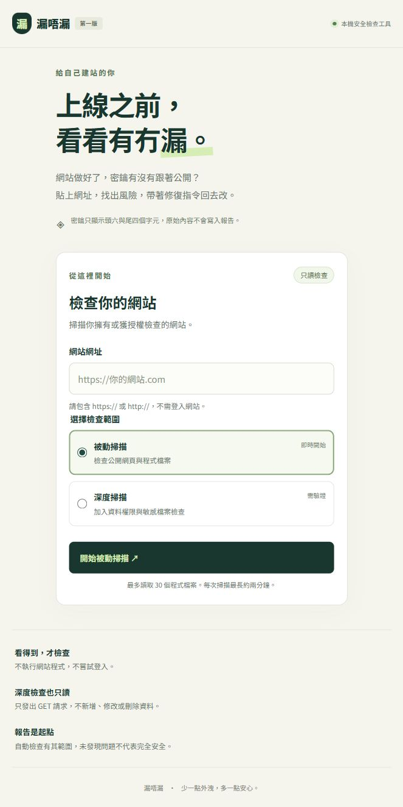
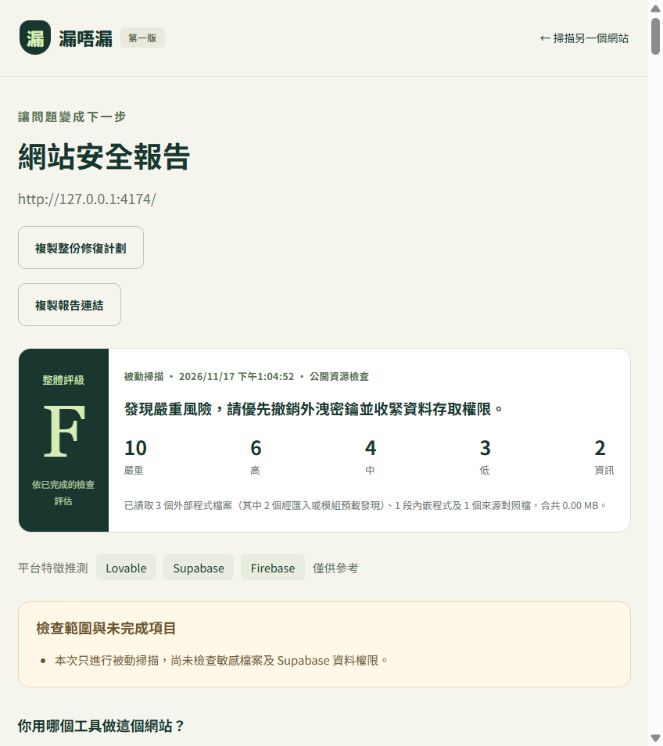

# 漏唔漏 · Vibe Leak Scan

[繁體中文](README.md) · English

**A local security checker for site owners: find suspected frontend secret leaks and configuration issues, then get Traditional Chinese reports and repair prompts for AI building tools.**

Enter a site you own or are authorized to assess, choose a scan scope, and work through the findings. Deep scans require ownership verification. A clean report is not a security certification.

This portfolio project implements v1, v1.1, and v1.2 of [SPEC.md](SPEC.md), with optional hosted trial mode described in the [deployment guide](docs/HOSTING.md). It was developed with AI assistance. [Verification records](VERIFICATION.md) distinguish checks actually run from external feedback supplied by the project owner.

## Screenshots

| Enter a URL and choose a scope | Review findings and scan coverage |
| --- | --- |
|  |  |

These are real browser screenshots of a local fixture. Fake credentials are assembled at runtime; the report displays masked evidence. Platform badges come from fixture strings and do not establish that deployments on those platforms were tested. See the [prompt screenshot and reproduction steps](docs/SHOWCASE.md) in Traditional Chinese.

## What it does

People using AI builders may not know which credentials are safe to expose, which database permissions need review, or how to turn a finding into a repair request.

Each finding includes an explanation, risk, suggested fix, masked evidence, and a five-part repair prompt. Prompts have Lovable, Bolt, Replit, coding-agent, and generic variants. Steps requiring human action, such as revoking an exposed key, are displayed separately. A combined repair plan groups findings by severity; failed clipboard operations reveal selectable text.

- **Public resources:** HTML, JavaScript, referenced source maps, static imports, re-exports, literal dynamic imports, and module preloads.
- **Secrets and configuration:** distinguishes private credentials from public identifiers; checks security headers and supported policies in head meta elements.
- **Verified deep checks:** exposed sensitive files and anonymous Supabase reads. Reports retain table and column names, not row values.
- **Coverage disclosure:** reports resource limits, fetch failures, and unresolved loads rather than treating those resources as checked.

The application UI, reports, and generated repair prompts remain in Traditional Chinese. This README provides an English introduction; detailed guides are in Traditional Chinese.

## Run locally

Use Node.js 22.x, version 22.8 or later. No build step or service credentials are required.

```powershell
npm install
npm test
npm start
```

Open `http://localhost:3000`. By default the service binds to `127.0.0.1` and accepts local interface access. Only scan sites you own or have permission to assess.

### Try the bundled fixture

After installing dependencies, open two PowerShell terminals in the project directory. The alternative ports below are also used by the screenshots.

In the first terminal:

```powershell
$env:PORT = '4300'
$env:ALLOW_PRIVATE_TARGETS = '1'
npm start
```

In the second terminal:

```powershell
$env:FIXTURE_PORT = '4174'
npm run fixture
```

Open `http://127.0.0.1:4300` and submit `http://127.0.0.1:4174` for a passive scan. Expect three external script files, two discovered through imports. The deliberately vulnerable fixture produces an F grade. All fixture credentials are fake, and its platform strings are test data.

Stop both processes with `Ctrl+C`. Close the test terminals or remove the test environment variables. `ALLOW_PRIVATE_TARGETS=1` is only for the local fixture, not normal scanning.

## Security design and tradeoffs

| Risk | Implementation | Evidence |
| --- | --- | --- |
| Access to private networks or cloud metadata through the scanner | Validate every DNS result; reject non-public addresses, pin sockets to validated IPs, and validate redirect destinations | [Network tests](tests/network.test.js) |
| Bypassing ownership through direct API calls | Bind verification to the origin, expire it after fifteen minutes, and re-read the proof before each deep scan; enforce the gate inside the scanner | [Ownership tests](tests/ownership.test.js), [HTTP integration tests](tests/integration.test.js) |
| Reports becoming another copy of a secret | Keep raw content in memory; sanitize findings before building prompts, and sanitize again before storage | [Scanner](src/scanner.js), [Storage](src/storage.js), [Integration tests](tests/integration.test.js) |
| Resource exhaustion | Ten seconds per request, two minutes per scan, 5 MB per resource, 25 MB total, and thirty JavaScript candidates across entry scripts, preloads, and imports | [Network tests](tests/network.test.js), [Import tests](tests/imports.test.js) |
| Executing target code or injecting report content into the page | Extract imports with string scanning; render external text using text nodes under a strict CSP | [Import extractor](src/imports.js), [App](src/app.js), [Report UI](public/report.js) |
| Repair advice that the detected platform cannot implement | Apply GitHub Pages limits only after detection; use supported meta policies where applicable and describe alternatives for header-only protection | [Platform and meta tests](tests/platforms-meta.test.js) |

The data flow is: validate the target, fetch within limits, inspect content in memory, mask findings, build tool-specific prompts, and save the report. Deep mode adds ownership verification before target scanning.

## A missed import became a regression case

External feedback on an early version showed that it read an entry script but missed another file loaded through an ES module import. The report did not explain that gap.

v1.2 added import traversal alongside coverage counts, unresolved-load notices, and explicit limitations. A three-level local fixture now places fake credentials in the second and third files, with regression tests for their detection, cycles, depth, file count, and byte limits. GitHub Pages detection and meta-policy handling were corrected without lowering risk grades because of platform limitations.

The [case study](docs/CASE-STUDY.md) separates the owner's external site report from reproducible local evidence. The current test suite does not establish that every AI builder or bundler output has been tested.

## Verification

```powershell
npm test
npm run verify:ssrf
node scripts/benchmark-imports.js
```

Run `verify:ssrf` in a terminal without `ALLOW_PRIVATE_TARGETS` set. The formal project copy was verified with **312 tests, 3 SSRF checks, and 14 local API checks, all passing**. Exact commands, earlier benchmark timings, and verification boundaries are recorded in [VERIFICATION.md](VERIFICATION.md).

Tests use local fixtures rather than real credentials or third-party scans. Benchmark timings apply to the specified synthetic inputs and machine, not every possible source file.

## Known limitations

- Target JavaScript is never executed. Import maps and paths constructed at runtime are not resolved. Conservative string scanning can also over-discover references.
- Secret detection checks formats and JWT roles, not whether a provider will accept a credential.
- Supabase checks retrieve at most one row per table. Empty or denied responses do not prove that every RLS policy is safe.
- Resource caps limit coverage. Non-200 responses and HTML fallbacks do not count as JavaScript; unsuccessful candidates still consume file slots.
- Platform detection uses recognizable signals. The external site feedback covers one plain static site, not representative production deployments of every AI builder.
- Reports have random URLs but no account-based access control. Anyone who knows a report link can read it. Hosted trial reports remain in memory for at most one hour and can disappear earlier after a restart or capacity eviction. All hosted visitors share five scan requests per minute.

## Stack and project guide

Node.js ESM, Express, parse5, and ipaddr.js; plain HTML, CSS, and JavaScript for the UI; local JSON reports; tests built with `node:test`.

| Path | Purpose |
| --- | --- |
| `src/` | Scanner, safe networking, verification, masking, prompts, storage |
| `public/` | Traditional Chinese UI and clipboard fallbacks |
| `fixtures/` | Local test site with fake credentials assembled at runtime |
| `tests/` | Unit, HTTP integration, and UI-logic tests |
| `scripts/` | Local regression checks and benchmark |
| `docs/` | Guides, case study, and actual demo screenshots |
| `data/` | Runtime reports; excluded by `.gitignore` |

Traditional Chinese guides: [Usage](docs/USAGE.md), [Three-minute demo](docs/DEMO.md), [Design review](docs/DESIGN-REVIEW.md), [Six-test tour](docs/TEST-TOUR.md).

## License and release status

This project uses the [MIT License](LICENSE), attributed to `itckt`, using the [Open Source Initiative text](https://opensource.org/license/mit). The source is public on [GitHub](https://github.com/Itckt/vibe-leak-scan).
