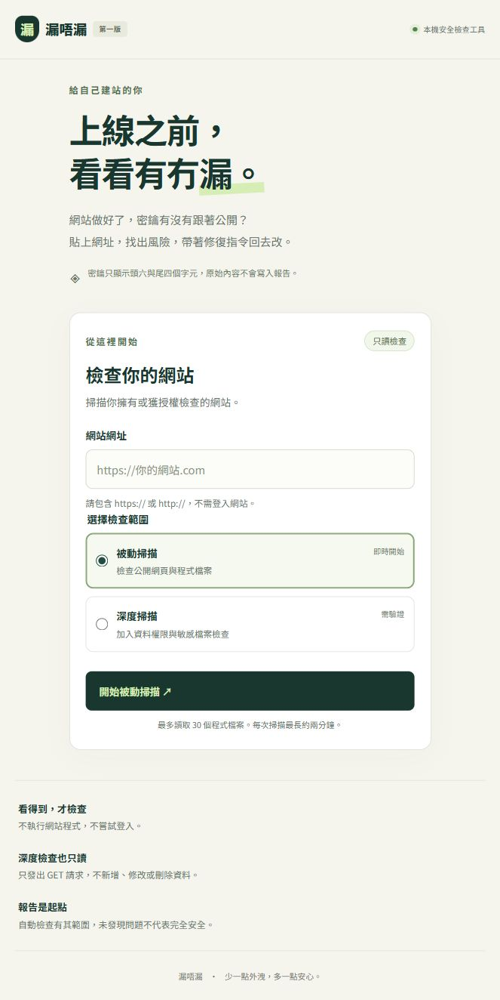
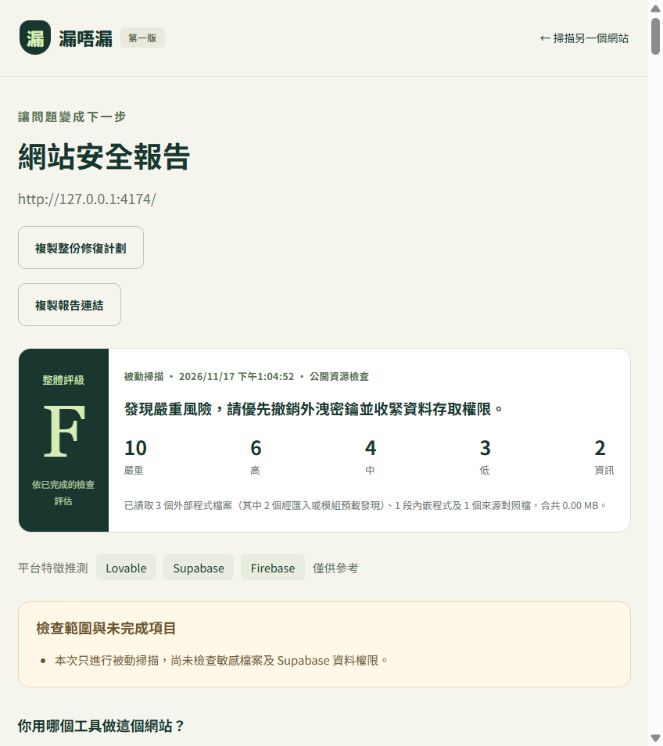
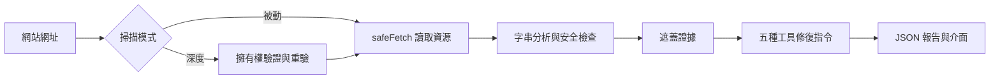

# 漏唔漏

繁體中文 · [English](README.en.md)

**給網站擁有者的本機安全檢查工具：找出前端疑似外洩密鑰與設定問題，產生繁體中文報告和可貼回 AI 建站工具的修復指令。**

貼上自己的網站網址，選擇檢查範圍，再按報告逐項修正。深度掃描必須先證明網站擁有權；未發現問題不代表網站完全安全。

這是可在本機執行、亦可部署為線上試用服務的作品專案，規格見 [SPEC.md](SPEC.md)。目前涵蓋 v1、v1.1 及 v1.2；安裝、API 與完整限制見[使用指南](docs/USAGE.md)，公開服務設定見[線上部署說明](docs/HOSTING.md)。

第一次看這個專案，可以先讀[三分鐘示範](docs/DEMO.md)，再沿著[設計與程式導覽](docs/DESIGN-REVIEW.md)及[六個安全測試](docs/TEST-TOUR.md)核對實作。專案採 AI 協作開發；驗證紀錄區分親自執行結果與使用者提供的外部回饋。

## 看看實際介面

| 貼上網址、選擇範圍 | 看見問題及實際掃描範圍 |
| --- | --- |
|  |  |

以上是真實瀏覽器截圖，掃描目標只限本機 fixture。假密鑰在執行時拼接，報告只呈現遮蓋後證據；畫面中的平台標記來自 fixture 的測試字串，不代表曾在那些平台部署。另見[修復指令畫面與重現步驟](docs/SHOWCASE.md)。

## 解決甚麼問題

AI 建站工具可以快速產生前端，但使用者未必知道哪些密鑰可以公開、哪些資料權限需要確認，或應該把修復指令貼去哪裡。

漏唔漏把發現整理成「問題、風險、修法、證據、驗收」。每項問題都有 Lovable、Bolt、Replit、程式碼代理及通用版本的五段修復指令；必須親手撤銷密鑰等步驟會另外標明。整份修復計劃按嚴重度合併，複製失敗時也會顯示可手動選取的文字。

- **公開資源檢查：** HTML、JavaScript、來源對照檔、靜態匯入、字面值動態匯入及模組預載。
- **密鑰與設定判讀：** 區分私密憑證、可公開的識別密鑰、安全標頭與有效的 head meta 政策。
- **驗證後的深度檢查：** 敏感檔案及 Supabase 匿名讀取；報告保留資料表與欄位名稱，不儲存資料列值。
- **如實說明覆蓋範圍：** 超出上限、無法讀取或無法解析的載入會列出未完成提示。

## 本機啟動

使用 Node.js 22.8 或以上的 22.x 版本；無需建置，也不需要服務金鑰。

```powershell
npm install
npm test
npm start
```

開啟 `http://localhost:3000`。預設只綁定 `127.0.0.1`，只接受本機介面存取。只掃描自己擁有或獲授權檢查的網站。

想完全離線示範，先依[本機 fixture 操作說明](docs/SHOWCASE.md)設定 `ALLOW_PRIVATE_TARGETS=1`，再啟動專案內的測試網站。這個例外只用於本機測試。

## 安全設計與取捨

| 要避免的風險 | 實際做法 | 驗證位置 |
| --- | --- | --- |
| 掃描器被借來存取內網或雲端中繼資料 | 驗證所有 DNS 位址、拒絕非公開位址；連線釘選已驗證 IP，重新導向再檢查 | `tests/network.test.js` |
| 直接呼叫 API 繞過擁有權 | 驗證綁定來源、十五分鐘失效；深度掃描前重新讀取標記，掃描器內再設門檻 | `tests/ownership.test.js`、`tests/integration.test.js` |
| 掃描報告變成另一份秘密副本 | 原始內容只留記憶體；先遮蓋證據，再建立修復指令及儲存報告 | `tests/integration.test.js` |
| 惡意資源耗盡時間或流量 | 每請求十秒、整次兩分鐘；每資源 5 MB、合共 25 MB；JavaScript 最多三十個候選檔案 | `tests/network.test.js`、`tests/imports.test.js` |
| 下載的程式被執行或外部文字注入介面 | 只做字串分析；介面用文字節點及嚴格 CSP，沒有執行目標程式 | `src/imports.js`、`src/app.js`、`public/report.js` |
| 報告寫出平台做不到的修法 | 確認 GitHub Pages 後才套用平台限制；可用 meta 的項目給出格式，其餘說明替代途徑 | `tests/platforms-meta.test.js` |



## 一次漏掃如何改變設計

v1.2 的起點是使用者提供的一次靜態網站實測：HTML 引用的入口檔有讀取，但入口檔透過 ES module 載入的另一個檔案沒有被檢查，報告也沒有交代這個缺口。

修正不只增加 import 追蹤，也加入來源計數、未完成提示與明確限制；再用三層本機 fixture、循環及超限案例建立回歸測試。GitHub Pages 辨識與 meta 政策判讀一併修正，風險評級維持原邏輯。完整過程與證據界線見[v1.2 修正案例](docs/CASE-STUDY.md)。

## 測試與驗證

```powershell
npm test
npm run verify:ssrf
node scripts/benchmark-imports.js
```

`verify:ssrf` 要在未設定 `ALLOW_PRIVATE_TARGETS` 的程序執行；端到端 fixture 驗證的啟動方式見[使用指南](docs/USAGE.md)。測試不依賴真實憑證或第三方網站。

加入線上模式後重新驗證：312 項測試、3 項 SSRF 檢查及 14 項本機 API 回歸全部通過。親自執行的指令、結果及未驗證項目集中記錄在 [VERIFICATION.md](VERIFICATION.md)，效能數字只代表列出的合成樣本與環境。

## 已知限制

- 不執行目標程式，不解析 import map，也無法還原執行時才組成的路徑；字串分析可能多跟隨疑似引用。
- 密鑰檢查驗證格式及 JWT 角色，不會呼叫供應商確認憑證是否有效。
- Supabase 每表最多讀取一列；空回應或拒絕存取都不足以證明全部 RLS 政策安全。
- 檔案及流量上限會限制覆蓋範圍。HTTP 非 200 或 HTML 回退不當成 JavaScript；失敗候選仍佔檔案名額。
- 平台辨識依特徵判斷。現有真站回饋只涵蓋一個純靜態網站，未把它視為所有 AI builder 或打包流程的驗證。
- 報告沒有帳戶登入保護；知道隨機報告連結的人可以讀取。線上試用版的報告只暫存記憶體，最多一小時，服務重啟或容量已滿時可能提前移除；所有訪客共用每分鐘五次掃描配額。

## 技術與導覽

Node.js 原生 ESM、Express、parse5、ipaddr.js；前端使用原生 HTML、CSS、JavaScript；報告以本機 JSON 儲存，測試使用 `node:test`。

```text
src/          掃描、安全網路層、擁有權、遮蓋、修復指令與儲存
public/       繁體中文介面與複製備援
fixtures/     只含執行時拼接假密鑰的測試網站
tests/        單元、HTTP 整合及介面邏輯測試
scripts/      本機回歸驗證與效能量測
docs/         使用指南、修正案例、示範截圖與設計導覽
data/         執行時產生的報告；已由 .gitignore 排除
```

[規格](SPEC.md) · [使用指南](docs/USAGE.md) · [示範與截圖](docs/SHOWCASE.md)

本專案採用 [MIT 授權](LICENSE)，署名為 `itckt`；授權原文依 [Open Source Initiative](https://opensource.org/license/mit)。原始碼已公開於 [GitHub](https://github.com/Itckt/vibe-leak-scan)。
