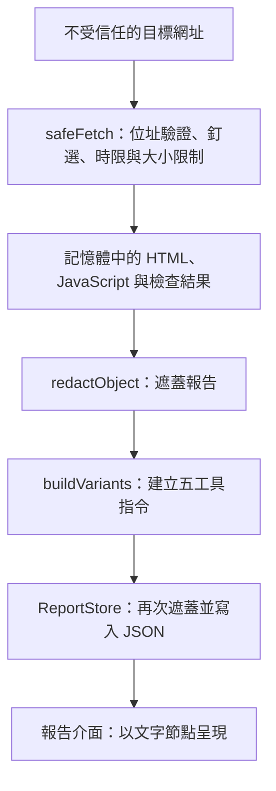

# 設計取捨與程式導覽

這份導覽供作品審閱或面試準備使用。敘述對應現有程式，重點是能解釋處理順序、限制與證據；個人分工應依實際參與情況補充。

## 建議閱讀順序

| 順序 | 檔案 | 值得留意的設計 |
| --- | --- | --- |
| 1 | [scanner.js](../src/scanner.js) | `scan` 在深度模式先呼叫 `authorize`；所有資源共用 budget，最後先遮蓋才產生指令 |
| 2 | [network.js](../src/network.js) | `validateTarget` 檢查全部 DNS 結果；socket 使用已驗證位址，連線回退共用時限 |
| 3 | [verification.js](../src/verification.js) | 驗證綁定 origin、有期限；每次深度掃描重新讀取標記 |
| 4 | [imports.js](../src/imports.js) 與 [html.js](../src/html.js) | 字串擷取與 HTML 解析分開；不以執行程式來發現依賴 |
| 5 | [prompts.js](../src/prompts.js) 與 [storage.js](../src/storage.js) | 純函式接收已遮蓋問題；儲存前再做一次遮蓋 |
| 6 | [integration.test.js](../tests/integration.test.js) | 從 HTTP 送出掃描，到讀回磁碟報告，核對門檻與資料保護 |

## 四個重要邊界

深度掃描在讀取目標前還有擁有權門檻。圖中的遮蓋步驟是資料流設計；完整性仍要靠規則、測試及審閱確認，不能只因有呼叫某個函式就推論所有秘密都已被識別。

## 可以清楚說明的取捨

### 一、先定義可檢查範圍，再解讀「沒發現」

靜態分析不用執行不受信任的目標程式，仍可處理公開 script、來源對照檔與多數字面值 import。代價是 import map、執行時組成的路徑及其他執行語意不在目前能力內。

`coverage`、`notices` 與 `limitations` 因而是報告內容的一部分。深度及檔案上限留下未完成提示；裸模組名與非字面值載入會合併提示。HTTP 非 200 或 HTML 回退會靜默略過，不計成功讀取數。這些規則應一起解釋，不能把成功讀取數稱為完整依賴圖。

### 二、驗證全部 DNS 結果，再做連線回退

只驗證某一個 IP 不足以支持後續連線的安全判斷。本專案先檢查整組位址；任何結果不符合公開位址規則就拒絕，再把 socket 釘選到已通過的位址，避免連線時重新解析。

回退僅適用於收到回應前的連線失敗。仍有下一個位址時，連線階段最多三秒；最後一個位址用剩餘時間。各次嘗試共用原有時限及掃描 budget，HTTP 錯誤狀態或回應開始後的錯誤不重試。

### 三、擁有權門檻放在掃描器內

介面控制方便使用者操作，伺服器才決定是否允許深度檢查。`scan` 需要有效的 verificationId，`authorize` 會核對來源、期限、先前驗證結果與仍然存在的標記。

直接呼叫 API、偽造 `verified: true` 或只取得驗證碼都不會得到權限。驗證綁定 origin，也不把另一個網域或不同連接埠視為同一個目標。

### 四、修復指令也要經過資料邊界

指令會被複製到其他 AI 工具，因此不能讓完整密鑰隨修復文字再次外洩。掃描器先清理報告，再把已遮蓋問題交給沒有 I/O 的 `buildVariants`；原始程式及資料列值不應進入該模組。

純函式讓工具版本、警告、合併順序與舊報告相容性較容易測試。代價是生成器不會自行查詢平台能力，所以指令使用規格限定的概念，遇到未知支援情況要明確說明。

### 五、證據不足就保留不確定性

Supabase 公開密鑰不等於私密憑證外洩；匿名讀到資料列也不能單憑一次回應斷定 RLS 沒有啟用。資料可能刻意公開，也可能是政策過寬。工具保留資料表與欄位，要求確認用途，再決定權限修復。

GitHub Pages 的平台限制同樣不消除風險。meta 能生效的項目提供對應修法；需要 HTTP header 的項目保留原嚴重度，說明平台限制與替代交付方式。

## 評審可能追問的限制

| 追問 | 現有實作可以支持的回答 | 尚未支持的說法 |
| --- | --- | --- |
| 三十檔以後會怎樣？ | 共用候選名額；被略過的依賴產生上限提示 | 已覆蓋所有程式檔 |
| 5 MB 分析有多快？ | 可用合成樣本重跑並記錄本機耗時 | 所有輸入或所有機器都永遠不會卡住 |
| 報告會洩漏秘密嗎？ | 有遮蓋流程與落盤、日誌回歸測試 | 已證明能識別任何未知格式的秘密 |
| 支援 AI builder 嗎？ | 有五工具修復指令矩陣與本機 fixture | 已在各平台的真實部署全面驗收 |
| 可以直接架成公眾服務嗎？ | 目前為本機服務，具備 SSRF、限流及驗證門檻 | 已完成公眾部署、帳戶隔離與營運安全設計 |

## 如何交代 AI 協作

作品紀錄可以說明：透過規格驅動的多輪 AI 協作完成實作，再用自動測試、瀏覽器操作與回饋修正缺口。展示時應分開說明需求提出、程式產出、審閱與執行驗證由誰完成；只把自己親自做過的部分列為個人貢獻。

面試前至少自行走一次[示範](DEMO.md)，讀過上方六個閱讀入口，並能解釋一個測試的斷言及其未覆蓋範圍。測試數量可以作背景，具體安全不變條件才是可審閱的證據。

[回到 README](../README.md) · [安全測試導覽](TEST-TOUR.md) · [v1.2 修正案例](CASE-STUDY.md)
